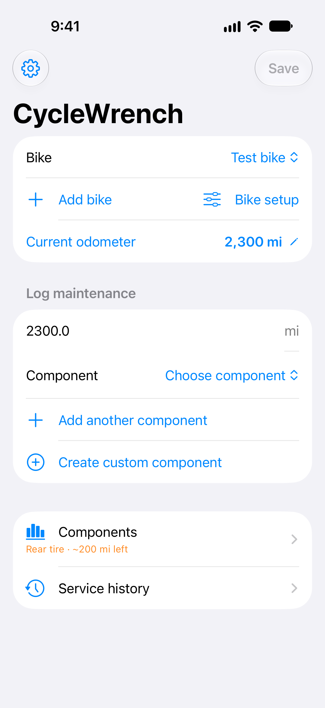
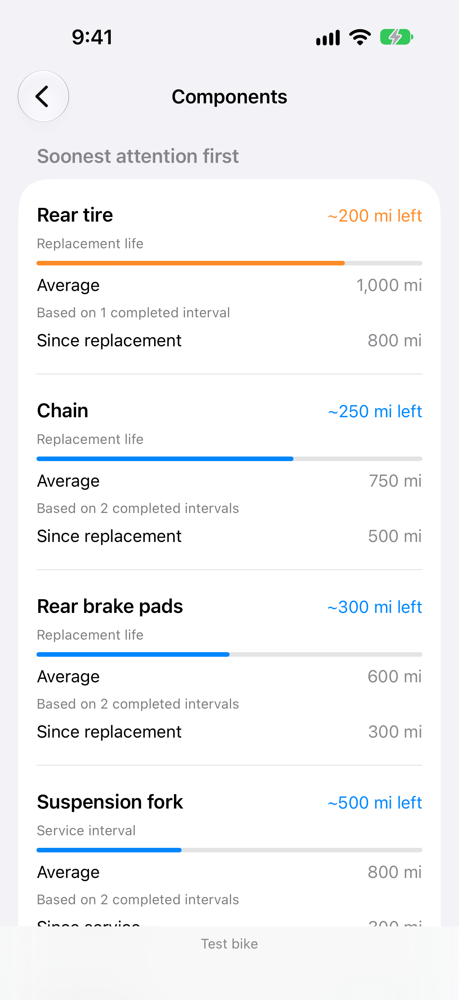

# CycleWrench


[](https://github.com/irodrigo17/CycleWrench/actions/workflows/build.yml)
[](https://www.swift.org/)
[](project.yml)
[](LICENSE)
[](https://github.com/irodrigo17/CycleWrench/commits/main/)

A simple, local-first bicycle maintenance journal for iOS.
Enter your current odometer, select the components you replaced or serviced,
and save. View your maintenance history in one list.

Supports bicycle drivetrain, brakes, tires, bearings and suspension components.
Built with SwiftUI and SwiftData. No separate app account, analytics, or third-party dependencies. Signed device builds use private iCloud sync.

<p>
  
  
</p>

[App Store media](AppStore/) · [Competitor research](docs/CompetitorResearch.md)

## Get started

Requires Xcode with the iOS SDK, and XcodeGen 2.45 or later.

```sh
brew install xcodegen
make generate
open CycleWrench.xcodeproj
```

Choose an iOS simulator and run. For a device, select your development team in
Xcode and use the bundle identifier registered in your Apple Developer account.
The registered app identifier is `com.cyclewrench`. Configure the private CloudKit
container `iCloud.com.cyclewrench` following [iCloud setup](docs/iCloudSetup.md). Never commit developer-specific signing changes.

```sh
make build
```

`project.yml` is the source of truth; the generated Xcode project is ignored.
GitHub Actions regenerates the project and compiles for the iOS simulator.

## Initial scope

Supports multiple named bicycles, an app-wide kilometer/mile display setting, independent
odometers and service histories, multi-component logging, and odometer-only updates.
Readings cannot decrease. Existing history is adopted into a “My bike” record on first launch.
This is an additive SwiftData migration; original component identifiers and readings are preserved.

Component estimates show the average completed interval, sample count, distance
since the latest event and approximate distance remaining. The Components screen
sorts by remaining distance, with unknown intervals last. Approaching average means
20% or less of the historical average remains; passing it is not a wear measurement.
At least two records are needed. Replacement life and servicing intervals are
separate, and a replacement breaks the service cycle. Time/hour-based suspension
limits are not inferred from distance.

Settings applies kilometers or miles across all bikes and history. Existing stored
units are retained and explicitly converted before display and interval calculation.
New bikes store kilometers internally.

Next: editing/deleting entries, bike renaming, and export/backup.

## Distribution

App Store Connect app ID: **6827839532**.

Before distribution: verify the registered bundle identifier, configure signing,
add an app icon, complete privacy/support metadata, test on devices and submit
through TestFlight. The repository scaffold is not a release-ready submission.

## License

MIT. See [LICENSE](LICENSE).

## Tests and CI

```sh
make test
```

This regenerates the project, selects an installed iPhone simulator, and builds
and runs the unit tests with coverage. Override the device if needed:

```sh
make test DESTINATION='platform=iOS Simulator,id=YOUR_SIMULATOR_UUID'
```

GitHub Actions runs the same command on pushes and pull requests, using a macOS
runner and an available iPhone simulator. Test results and coverage are uploaded
as an `.xcresult` artifact for seven days, including on failure. No signing keys
or Apple account secrets are needed. Manual runs are available in Actions.

Tests cover store migrations, multi-bike isolation, odometer-only updates,
component filtering, custom components, imports and lifespan calculations.
Automated test hosts use in-memory storage; fixtures use synthetic test bikes.
Manual app checks must use a test bike, never the rider's Orbea Wild.

## iCloud

Signed device builds use private CloudKit sync. Apple Developer container setup,
provisioning and Production schema deployment are required before distribution.
See [setup and device acceptance checks](docs/iCloudSetup.md). Unsigned simulator
builds store data locally; cloud restore has to be verified on signed devices.

## Importing notes

Use Settings → Import service log for a JSON archive. See [the import format](docs/ImportFormat.md).
Undated entries retain their odometers and show “Date not recorded”. Bearings
support freeform notes for frame pivots or any other assembly. Personal archives
are excluded from the repository; no rider's actual service history is shipped.

## Bike setup

Add a bike or choose **Bike setup** next to the bike selector to edit its name,
power type, suspension and brakes. Motor and battery are available for electric
bikes; hardtails omit the rear shock and rigid bikes omit both suspension parts.
Disc rotors are hidden for rim brakes, and bleeding is hidden for mechanical
brakes. Unset fields keep options available until the rider chooses a setup.
Existing service history and component estimates are never deleted or hidden by
setup changes. Battery and motor work can include notes, e.g. warranty replacement;
intervals require actual odometer records, just like other components.

New setup fields migrate additively with an `unspecified` default and sync through
CloudKit alongside the bike. Configuring bikes remains optional.

## Simple logging

Tap **Current odometer** to update mileage without service. **Service history**
opens a secondary screen alongside Components. Every selected component has its
own action, defaulting to the usual work (e.g. replace chain/pads, service fork/shock),
so one save can mix replacements and services.

Choose **Create custom component** to name a part, choose its default action and
optionally track front and rear separately. Custom definitions can be available to all bikes or restricted by power, suspension
and brake setup, and are included in private iCloud sync. Stored history keeps the name
and stable component identity even if its definition is later removed. Custom
components participate in the same interval and remaining-distance calculations.

## Adaptive layout

The home screen follows Bike → Log maintenance → Components / Service history.
`NavigationSplitView` keeps logging and review side by side when the window has
space, and collapses into a navigation stack in narrow windows. It adapts to iPad
multitasking, rotation and iPhone Duo display changes without device-name checks
or fixed full-screen dimensions. Phone drafts and selected bike remain in the
same view state while the available space changes.

Custom component restrictions are optional and combined across power, suspension
and brake type. Existing definitions migrate to all bikes. A bike with an unset
setup field keeps matching options available until configured. Restrictions
filter new logging choices and never hide or delete recorded history.
